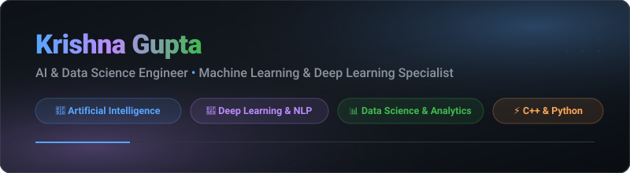

<div align="center">

  <!-- SVG Header Banner -->
  

  <br/><br/>

  <!-- Dynamic Typing SVG Banner -->
  <a href="https://github.com/KGupta171025">
    
  </a>

  <br />

  <!-- Social & Quick Action Badges -->
  <a href="https://linkedin.com/in/krishnaofficialgupta" target="_blank">
    
  </a>
  <a href="https://kgupta.is-a.dev" target="_blank">
    
  </a>
  <a href="mailto:kgupta.171025@gmail.com">
    
  </a>
  <a href="https://instagram.com/kgupta_official" target="_blank">
    
  </a>

  <br/><br/>

  <!-- Status & Profile Visitor Badges -->
  
  
  

</div>

<hr />

## 👨‍💻 Executive Summary

```yaml
Name: Krishna Gupta
Role: AI & Data Science Engineer | Machine Learning Specialist
Location: Bhopal, Madhya Pradesh, India
Core Focus: Artificial Intelligence, Deep Learning, NLP, Generative AI & Data Analytics
Languages: Python, C++, SQL, JavaScript, Solidity
Passion: Designing intelligent autonomous agents, neural consensus engines & predictive data models
```

- 🔭 **Currently Building**: **[KALKI-1.5](https://github.com/KGupta171025/KALKI-1.5)** — An Enterprise Intelligence Operating System (eIOS) combining LLMs, vLLM, autonomous multi-agents, hybrid RAG, and defensive cybersecurity mechanisms.
- 🌱 **Deepening Expertise In**: Advanced Transformer Architectures, Distributed Model Training, Computer Vision & Hybrid RAG Pipelines.
- 👯 **Open for Collaboration**: High-impact Open Source AI/ML systems, NLP frameworks, and Data Science benchmarks.
- 💬 **Ask Me About**: Machine Learning models, Neural Networks, NLP, Data Visualization (Power BI & Excel), and C++ Data Structures & Algorithms.
- ⚡ **Engineering Philosophy**: Bridging theoretical AI research with production-grade engineering to build reliable, high-performance intelligent systems.

---

## 🛠️ Tech Stack & Core Competencies

### 🧠 Artificial Intelligence, Machine Learning & Deep Learning
<p fill="left">
  
  
  
  
  
  
  
</p>

### 💻 Programming Languages & Blockchain
<p fill="left">
  
  
  
  
  
  
  
</p>

### 📊 Data Analytics, Business Intelligence & Visualization
<p fill="left">
  
  
  
  
</p>

### 🔧 Tools, Cloud & Development Environments
<p fill="left">
  
  
  
  
  
  
</p>

---

## 🚀 Featured Projects Spotlight

<table>
  <tr>
    <td width="50%" valign="top">
      <h3 align="center">🌐 Krishna-Gupta-Portfolio</h3>
      <p align="center">
        
        
        
      </p>
      <p>Interactive 3D portfolio & resume showcasing journey in Data Science, AI, Machine Learning, Deep Learning, NLP, LLMs, Python, Generative AI, Computer Vision, and Software Development.</p>
      <p align="center">
        <a href="https://kgupta.is-a.dev" target="_blank"><b>Live Demo »</b></a> | 
        <a href="https://github.com/KGupta171025/Krishna-Gupta-Portfolio"><b>Code »</b></a>
      </p>
    </td>
    <td width="50%" valign="top">
      <h3 align="center">🤖 KALKI-1.5</h3>
      <p align="center">
        
        
        
      </p>
      <p>KALKI AI (Krishna Artificial Lattice Keystone Intelligence) is an Enterprise Intelligence Operating System (eIOS) combining LLMs, VLMs, autonomous multi-agents, hybrid RAG, and defensive cybersecurity.</p>
      <p align="center">
        <a href="https://kgupta171025.github.io/KALKI-1.5/" target="_blank"><b>Live Demo »</b></a> | 
        <a href="https://github.com/KGupta171025/KALKI-1.5"><b>Code »</b></a>
      </p>
    </td>
  </tr>
  <tr>
    <td width="50%" valign="top">
      <h3 align="center">⛓️ Neural-Consensus-Engine</h3>
      <p align="center">
        
        
        
      </p>
      <p>Decentralized AI consensus engine leveraging smart contracts and neural verification protocols for secure, decentralized multi-party AI task validation.</p>
      <p align="center">
        <a href="https://github.com/KGupta171025/Neural-Consensus-Engine"><b>Explore Repository »</b></a>
      </p>
    </td>
    <td width="50%" valign="top">
      <h3 align="center">👁️ FOG Technologies Computer Vision Engineer</h3>
      <p align="center">
        
        
        
      </p>
      <p>Advanced computer vision algorithms, real-time edge visual perception, and intelligent video analytics pipelines engineered during Computer Vision role at FOG Technologies.</p>
      <p align="center">
        <a href="https://github.com/KGupta171025/FOG_Technologies_Computer_Vision_Engineer"><b>Explore Repository »</b></a>
      </p>
    </td>
  </tr>
  <tr>
    <td width="50%" valign="top">
      <h3 align="center">⚡ Razor-Recovery</h3>
      <p align="center">
        
        
        
      </p>
      <p>Automated disaster recovery, system state synchronization, and intelligent resilience orchestration toolkit for high-reliability data infrastructure and mission-critical systems.</p>
      <p align="center">
        <a href="https://github.com/KGupta171025/Razor-Recovery"><b>Explore Repository »</b></a>
      </p>
    </td>
    <td width="50%" valign="top">
      <h3 align="center">📚 SHELF-SCANNER</h3>
      <p align="center">
        
        
        
      </p>
      <p>AI-powered book discovery app that recognizes books from images using Computer Vision and OCR, then recommends similar books using embeddings, semantic search, and recommendation algorithms.</p>
      <p align="center">
        <a href="https://kgupta171025.github.io/SHELF-SCANNER/" target="_blank"><b>Live Demo »</b></a> | 
        <a href="https://github.com/KGupta171025/SHELF-SCANNER"><b>Code »</b></a>
      </p>
    </td>
  </tr>
</table>

---

## 📊 Dynamic GitHub Activity & Metrics

<div align="center">
  <br />
  <a href="https://github.com/KGupta171025">
    
    
  </a>
  <br/><br/>
  <a href="https://github.com/KGupta171025">
    
  </a>
</div>

---

## 💬 Connect & Socials

<div align="center">
  
  [](https://linkedin.com/in/krishnaofficialgupta)
  [](https://kgupta.is-a.dev)
  [](mailto:kgupta.171025@gmail.com)
  [](https://instagram.com/kgupta_official)

</div>

<br />

<div align="center">
  <sub><i>"The best way to predict the future is to invent it with Code &amp; Intelligence."</i></sub><br/>
  <sub>© 2026 Krishna Gupta. Built with passion &amp; Artificial Intelligence.</sub>
</div>
